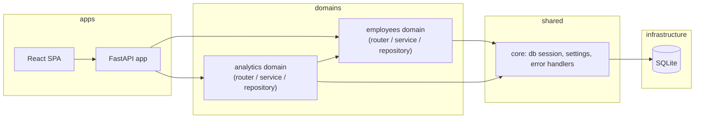

# Architecture

> Extracted from [`docs/specs/001-employee-salary-management-spec.md`](docs/specs/001-employee-salary-management-spec.md) §7. This is the project-wide architectural reference; the spec's §7 is its origin, not a duplicate to keep in sync by hand — update here first, then link back.

## 1. Style and rationale

**Style:** Modular monolith, with domain-based vertical modules internally layered (router → service → repository).

A single deployable process fits ACME's 10,000-employee scale — there is no independent-scaling or independent-deployment need that would justify microservices, and a single-team build gains nothing from that operational overhead. Domain-based module boundaries (`employees`, `analytics`) keep each feature self-contained and independently testable, while router/service/repository layering inside each domain gives dependency-inversion and fail-fast-at-the-boundary properties without spreading one feature's logic across a project-wide layer split.

## 2. Tech stack

| Layer | Choice | Rationale |
|---|---|---|
| Backend runtime | FastAPI (Python 3.11+) | Async-capable, type-hinted, Pydantic v2 validation at the boundary, auto-generated OpenAPI docs. |
| Database | SQLite via SQLAlchemy 2.0 ORM | Zero-ops, sufficient at 10,000 rows; repository layer isolates SQL so a later move to Postgres is a connection-string change. |
| Hosting | Local/dev only (`uvicorn` + Vite dev server) | No cloud hosting in scope. |
| Auth | None | Single implicit HR Manager persona (accepted limitation, spec §9.3). |
| Frontend UI | React 18 + TypeScript + MUI v5 + MUI X DataGrid (Community) + MUI X Charts (Community) | Accessible, sortable, server-paginated tables over 10,000 rows without hand-rolled virtualization. |
| Frontend data/forms | TanStack Query + react-hook-form | Server-driven state fits a CRUD-plus-analytics app with no real-time requirement. |
| Seed data | `Faker`, fixed RNG seed | Deterministic, realistic generated data. |
| Testing | pytest + FastAPI `TestClient` (backend); Vitest + React Testing Library (frontend) | Fast, deterministic, in-process. |

## 3. Dependency rules

- `router` → `service` → `repository` → SQLAlchemy models. Never the reverse.
- `service` never imports FastAPI request/response types or the `router` module.
- `repository` never imports `service`.
- The `analytics` domain depends on `employees` only through its public service interface — never its repository or models directly.
- Frontend: `features/<domain>/` components depend on that domain's API client hooks; no feature imports another feature's internals directly (shared UI lives in `shared/`).

## 4. Module map

| Module | Responsibility | Path (target, greenfield) |
|---|---|---|
| `employees` domain | Employee CRUD, search/filter, deactivation; owns the `Employee` model | `backend/app/employees/` |
| `analytics` domain | Aggregate pay queries (by department, by country, pay bands) | `backend/app/analytics/` |
| `core` | DB session/engine, settings, shared error handling, reference data (Department/Country/Currency) | `backend/app/core/` |
| Seed script | Deterministic 10,000-employee data generation | `backend/app/scripts/seed.py` |
| `features/employees` | Directory, profile, add/edit/deactivate UI | `frontend/src/features/employees/` |
| `features/analytics` | Analytics dashboard UI | `frontend/src/features/analytics/` |
| `shared` | Cross-feature UI (layout, nav, API client base) | `frontend/src/shared/` |

## 5. Cross-cutting concerns

- **Auth:** none in v1 (see spec §9.3).
- **Validation:** Pydantic schemas at every router boundary; internal layers trust validated input.
- **Error handling:** a shared FastAPI exception handler maps domain errors to `{code, message}` JSON responses with the correct HTTP status (404 for not-found, 422 for validation).
- **Logging:** no full employee records logged (salary data is sensitive PII); log request path and status only.
- **Migrations:** none in v1 — schema is created via SQLAlchemy metadata at seed time, appropriate for a single-environment kata; a real deployment would introduce Alembic.
- **Observability:** none beyond FastAPI's default access logging — no metrics/tracing stack in scope.

## 6. Integration points

None. The system has no external service dependencies — the FX-to-USD conversion table is a static seeded snapshot, not a live external call (spec §9.4).

## 7. Forbidden anti-patterns

- Cross-domain repository imports (`analytics` reaching into `employees`' repository or models directly).
- Business logic written directly inside a router function.
- Raw SQL strings outside the repository layer.
- Shared mutable module-level state.
- A project-wide `controllers/` / `services/` / `models/` split instead of domain-based folders.

## 8. How to evolve

- **Adding a domain module** (e.g. a future `payroll` domain): create `backend/app/<domain>/{router,service,repository}.py` and `frontend/src/features/<domain>/`; wire the router into the FastAPI app; do not import across domains except through a service's public interface.
- **Splitting a domain:** once a domain's service file exceeds a few hundred lines or mixes clearly separate concerns, split into sub-modules under the same domain folder rather than promoting to a new top-level domain prematurely.
- **Deprecating a module:** remove its router registration first (cuts external reachability), then delete the module in a follow-up commit once nothing imports it — never leave dead code behind (Incubyte "no dead code" standard).

## 9. Decision records (ADRs)

**ADR 1 — Modular monolith with domain-based vertical modules.** See §1 above for the full rationale. Alternatives considered and rejected: microservices (unjustified operational cost at this scale), project-wide technical layering (violates the domain-folder-structure standard and scatters each feature across three unrelated top-level directories).

## 10. References

- Spec: [`docs/specs/001-employee-salary-management-spec.md`](docs/specs/001-employee-salary-management-spec.md), §7 Architecture.
- Requirements: [`docs/requirements.md`](docs/requirements.md).
- Standards: `mcp__plugin_anthara_anthara-fabric__get_relevant_standards` / `list_standard_packs` — Clean Code (dependency direction, fail-fast boundaries), Incubyte Engineering Standards (domain-based folder structure).
