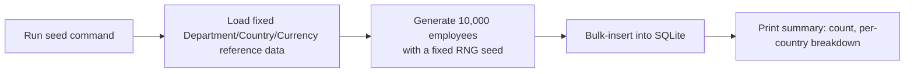
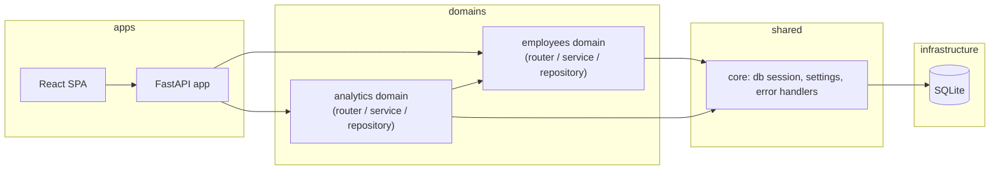

# Spec: Give ACME's HR Manager a web application to manage and analyze salary data for 10,000 employees across multiple countries

> Owned by: Avani (candidate build, Python role assessment)  ·  Started: 2026-09-29  ·  Last revised: 2026-09-29  ·  Spec UUID: 3f1a2e9c-8b7d-4c6a-9e2f-7d5b6a1c4e80
> Anthara spec — slice-decomposed, categorically-framed. Feeds /anthara:create-ticket and /anthara:plan-implementer.

---

## At a glance

| | |
|---|---|
| **In one line** | Replace ACME HR's spreadsheets with a web app to manage 10,000 employees' salary data and answer "how does the org pay people?" |
| **Slices** | 8, built in the order listed in [§5](#5-slices) |
| **Architectural style** | Modular monolith, domain-based vertical modules — see [§7.2](#72-architectural-style) |
| **Active packs** | Clean Code, Incubyte Engineering Standards, Accessibility Checklist, SonarJS Violations (frontend TS scope only) |
| **Open questions** | 0 — all scoping decisions confirmed in this session; see [§8](#8-open-questions) |

## 1. Overview & business context

**The problem.** ACME's HR team manages salary data for 10,000 employees across multiple countries entirely in spreadsheets. This is tedious, error-prone, and makes it hard to answer aggregate questions like "what's our average pay by department?" — spreadsheets don't scale to structured queries at this volume.

**Who it is for.** The **HR Manager** (from [§3.1](#31-kinds-of-users)) — a single persona who needs to look up, add, and edit individual employee salary records, and to answer org-wide pay questions without building a pivot table by hand.

**What this spec commits to.** An employee directory (browse/search/filter/add/edit/deactivate) backed by a relational database, plus an analytics view answering aggregate pay questions (by department, by country, by pay band), seeded with 10,000 realistic employees. Outside-in, this is a directory screen, a profile screen, and an analytics screen, wired to a REST API.

**Deliberately out of scope.** Authentication, payroll processing, salary history over time, live currency conversion, and multi-org support are not built — see [§9](#9-deferred-follow-ups-and-accepted-limits) for the reasoning behind each.

## 2. Sources

| ID | Type | Contributor | Date | Description |
|---|---|---|---|---|
| 1 | Assignment brief | `kata.md` (repo root) | 2026-09-29 | Persona, problem statement, technical constraints, and deliverables for this assessment |
| 2 | Codebase (this repo) | n/a | 2026-09-29 | Greenfield repository containing only `kata.md`; no pre-existing stack or conventions to inherit |
| 3 | Org Memory (`mcp__plugin_anthara_anthara-fabric__search_memories`: "employee salary management HR Python FastAPI architecture") | Fabric | 2026-09-29 | No relevant prior facts returned; this spec is synthesized fresh, not inherited |
| 4 | Fabric standards (`mcp__plugin_anthara_anthara-fabric__get_relevant_standards` / `list_standard_packs`) | Fabric | 2026-09-29 | Active packs: Clean Code, Incubyte Engineering Standards, Accessibility Checklist, SonarJS Violations (frontend-only). SOC 2 Agent Verification Controls pack excluded — its own scope note reads "Not for: isolated feature logic with no infrastructure or control surface," which describes this kata (no production deployment, no CI/CD pipeline, single local app) |
| 5 | Live spec-writing session with Avani | Avani | 2026-09-29 | Tech stack (FastAPI/SQLAlchemy/SQLite, MUI + MUI X DataGrid), analytics scope (snapshot aggregates), and currency-handling (native currency + static FX snapshot) decisions confirmed via `AskUserQuestion` |
| 6 | `ARCHITECTURE.md` (repo root) | n/a | 2026-09-29 | §7 of this spec extracted into the project-wide architectural reference for future Anthara commands |

## 3. Type ontology

### 3.1 Kinds of users
- **HR Manager** — the sole persona in v1; browses, searches, adds, edits, and deactivates employee records, and reads the analytics view. No login — a single implicit user, per the accepted limitation in [§9.3](#9-deferred-follow-ups-and-accepted-limits) [1, 5].

### 3.2 Kinds of data
- **Employee** — first/last name, email, job title, department, country, hire date, salary amount, salary currency (derived from country), status. The record HR manages directly [1].
- **Department** — a fixed reference list (e.g. Engineering, Sales, Finance) an employee belongs to exactly one of [1].
- **Country** — a fixed reference list an employee is based in; determines the employee's salary currency [1, 5].
- **Currency snapshot** — a static, seed-time exchange rate to USD per currency code, used only for cross-country analytics comparison, never for the employee's stored native amount [5].

### 3.3 Kinds of events
- **EmployeeCreated** — fires when the HR Manager adds a new employee via [slice 5.5](#55-add-a-new-employee).
- **EmployeeUpdated** — fires when details or salary are edited via [slice 5.6](#56-edit-an-employees-details-and-salary).
- **EmployeeDeactivated** — fires when the HR Manager deactivates a record via [slice 5.7](#57-deactivate-an-employee); never a hard delete.

### 3.4 Kinds of states
- **Active** — the default state; counted in analytics by default.
- **Inactive** — set by deactivation; excluded from headline analytics unless explicitly included, per [invariant 4.4](#4-invariants).

## 4. Invariants

**4.1 One department, one country, one currency per employee** — every employee belongs to exactly one department and one country, and their salary currency is always the currency implied by their country. Sources: [1, 5].

**4.2 Salary is never negative** — an employee's salary amount is always a non-negative number, denominated in their native currency, validated at the API boundary before it reaches storage. Sources: [1, 4].

**4.3 Deactivation never deletes** — deactivating an employee changes their status to Inactive; it never removes the row. Historical salary data survives so aggregate figures remain correct even after headcount changes. Sources: [1, 5].

**4.4 Analytics defaults to active employees, never silently mixes states** — aggregate figures (averages, medians, distributions) are computed over Active employees unless the HR Manager explicitly opts to include Inactive ones; the toggle state is always visible on screen. Sources: [5].

**4.5 A country maps to exactly one currency** — the country reference list is the single source of truth for an employee's currency; two countries may share a currency (e.g. Germany and France both use EUR), but one country never maps to two. Sources: [5].

## 5. Slices

Outside-in, independently testable, sequenced for build. This table is the build order — `/anthara:plan-implementer` executes it top to bottom — and its last two columns are the wiring contract.

| # | Slice | What the user can do once it lands | Entry | Reached from |
|---|---|---|---|---|
| 5.1 | Seed the organisation's employee data | Generate a deterministic 10,000-employee dataset from a single command | CLI: `python -m backend.scripts.seed` | `root` |
| 5.2 | Browse the employee directory | See a paginated, sortable table of all employees on load | Employee Directory screen | `root` (app shell) |
| 5.3 | Search and filter the employee directory | Narrow the directory by name, department, country, and status | Search/filter bar on the Directory screen | 5.2 |
| 5.4 | View an employee's full profile | Click a row to see one employee's full record | Directory table row | 5.2 |
| 5.5 | Add a new employee | Onboard a new hire via a form | "Add Employee" button | 5.2 |
| 5.6 | Edit an employee's details and salary | Correct details or record a salary change | "Edit" button on the Profile screen | 5.4 |
| 5.7 | Deactivate an employee | Mark a departed employee Inactive without deleting history | "Deactivate" action on the Profile screen | 5.4 |
| 5.8 | View org-wide pay analytics | See headcount, avg/median/min/max salary by department and country, and pay-band distribution | "Analytics" nav tab | `root` (app shell) |

### 5.1 Seed the organisation's employee data

Running one command populates a fresh database with 10,000 employees distributed realistically across ~9 departments and ~10 countries (with their implied currencies), each with a plausible name, email, job title, hire date, and salary appropriate to their department/country. The same random seed always produces the same dataset, so tests and demos are reproducible.

*Types: [Employee, Department, Country, Currency snapshot](#32-kinds-of-data) · Invariants: [4.1, 4.2, 4.5](#4-invariants).*



**Acceptance criteria** (markdown checklist; mark `[x]` as the AC is implemented and verified)

- [x] **5.1.1** Running the seed command against an empty database creates exactly 10,000 Employee rows.
- [x] **5.1.2** Running the seed command twice with the same seed value produces byte-identical generated data (same names, same salaries, same distribution) — determinism per invariant 4.2's testability need.
- [x] **5.1.3** Every generated employee has a department from the fixed department list, a country from the fixed country list, and a salary currency matching that country's currency (invariant 4.1, 4.5).
- [x] **5.1.4** Every generated salary amount is a positive number (invariant 4.2).
- [x] **5.1.5** Running the seed command against a non-empty database refuses to run (or requires an explicit `--reset` flag) rather than silently duplicating data.

### 5.2 Browse the employee directory

On opening the app, the HR Manager sees a table of employees — name, department, country, job title, salary (native currency), status — loaded from the server in pages rather than all 10,000 at once, sortable by clicking a column header.

*Types: [Employee](#32-kinds-of-data) · Invariants: [4.1](#4-invariants).*

```
+--------------------------------------------------------------+
| ACME HR  [Directory] [Analytics]                              |
+--------------------------------------------------------------+
| Search: [__________]  Dept: [All v]  Country: [All v]  ...    |
+------+-----------+------------+---------+-----------+--------+
| Name | Department | Country   | Title   | Salary    | Status |
+------+-----------+------------+---------+-----------+--------+
| ...  | ...       | ...        | ...     | ...       | Active |
+------+-----------+------------+---------+-----------+--------+
|                                             < 1 2 3 ... 400 > |
+--------------------------------------------------------------+
```

**Acceptance criteria**

- [x] **5.2.1** `GET /api/employees?page=1&pageSize=50` returns 50 employees and a total count, not all 10,000, within one response.
- [x] **5.2.2** The Directory screen renders the first page of employees within 2 seconds on a local dev environment against the full 10,000-row seeded dataset.
- [x] **5.2.3** Clicking a column header (e.g. Salary) re-sorts the table via a server-side sort parameter, not client-side re-sorting of only the loaded page.
- [x] **5.2.4** Requesting a page beyond the last available page returns an empty list with a 200 status, not an error.
- [x] **5.2.5** The table reflows to a single scrollable column at 320px viewport width without introducing horizontal page scroll (Accessibility Checklist — reflow rule).

### 5.3 Search and filter the employee directory

The HR Manager narrows the directory by typing a name/email fragment and/or picking a department, country, or status from dropdowns; the table updates to show only matching employees, still paginated.

*Types: [Employee, Department, Country](#32-kinds-of-data) · Invariants: [4.1](#4-invariants).*

**Acceptance criteria**

- [x] **5.3.1** `GET /api/employees?q=<fragment>` returns only employees whose name or email contains the fragment, case-insensitively.
- [x] **5.3.2** `GET /api/employees?department=<id>&country=<id>&status=active` combines all three filters with AND semantics.
- [x] **5.3.3** Filters and search combine with pagination and sorting from [slice 5.2](#52-browse-the-employee-directory) without conflicting query parameters.
- [x] **5.3.4** A search/filter combination matching zero employees renders an explicit "no matching employees" empty state, not a blank table.
- [x] **5.3.5** Filter dropdown inputs carry accessible labels associated via `<label for>` or `aria-label`, not placeholder-only labeling.

### 5.4 View an employee's full profile

Clicking a directory row opens that employee's full profile — every field the directory table doesn't show room for (hire date, full job title, email) alongside what it does.

*Types: [Employee](#32-kinds-of-data) · Invariants: [4.1](#4-invariants).*

**Acceptance criteria**

- [x] **5.4.1** `GET /api/employees/{id}` returns the full record for a valid id.
- [x] **5.4.2** `GET /api/employees/{id}` for a non-existent id returns 404 with a `{code, message}` body, not a 500.
- [x] **5.4.3** The Profile screen is reachable only via a directory row (per [§5](#5-slices) reachability), and its URL is directly bookmarkable/shareable (e.g. `/employees/{id}`).

### 5.5 Add a new employee

The HR Manager fills a form (name, email, department, country, job title, hire date, salary) and submits; on success the new employee appears in the directory.

*Types: [Employee, Department, Country](#32-kinds-of-data) · Invariants: [4.1, 4.2, 4.5](#4-invariants).*

**Acceptance criteria**

- [x] **5.5.1** `POST /api/employees` with a fully valid payload creates an employee and returns 201 with the created record including its new id.
- [x] **5.5.2** `POST /api/employees` with a negative or zero salary returns 422 with a field-level error, and no row is created (invariant 4.2).
- [x] **5.5.3** `POST /api/employees` with a missing required field (e.g. no department) returns 422 listing every invalid field, not just the first.
- [x] **5.5.4** `POST /api/employees` with a malformed email returns 422 without reaching the database.
- [x] **5.5.5** The salary currency is set automatically from the selected country and is not a free-text or independently editable field on the Add form (invariant 4.5).
- [x] **5.5.6** Name, email, and date-of-hire inputs on the Add form carry appropriate `autocomplete` attributes (Accessibility Checklist).

### 5.6 Edit an employee's details and salary

From the Profile screen, the HR Manager edits any field — most commonly the salary, e.g. recording a raise — and saves; the profile and directory both reflect the change immediately.

*Types: [Employee](#32-kinds-of-data) · Invariants: [4.1, 4.2, 4.5](#4-invariants).*

**Acceptance criteria**

- [x] **5.6.1** `PATCH /api/employees/{id}` with a new salary amount updates only the provided fields and returns the full updated record.
- [x] **5.6.2** `PATCH /api/employees/{id}` with a negative salary is rejected with 422 and the stored record is unchanged (invariant 4.2).
- [x] **5.6.3** `PATCH /api/employees/{id}` changing `country` also updates `salary_currency` to match, never leaving them inconsistent (invariant 4.5).
- [x] **5.6.4** `PATCH /api/employees/{id}` for a non-existent id returns 404.
- [x] **5.6.5** Editing and re-fetching the same employee reflects the update — no stale cached value shown on the Profile screen after save.

### 5.7 Deactivate an employee

From the Profile screen, the HR Manager deactivates an employee who has left the org; the record is marked Inactive, stays visible in the directory (clearly labeled) and profile, and drops out of default analytics figures.

*Types: [Employee](#32-kinds-of-data) · Invariants: [4.3, 4.4](#4-invariants).*

**Acceptance criteria**

- [x] **5.7.1** `POST /api/employees/{id}/deactivate` sets status to Inactive and returns the updated record; the row still exists afterward (invariant 4.3).
- [ ] **5.7.2** A deactivated employee is excluded from default (Active-only) aggregate figures anywhere the system reports them, per [invariant 4.4](#4-invariants).
- [x] **5.7.3** Deactivating an already-Inactive employee is idempotent — a second call returns 200 with no error, status stays Inactive.
- [x] **5.7.4** The Directory and Profile screens visibly label Inactive employees (e.g. a status badge), never hiding the distinction.

### 5.8 View org-wide pay analytics

The HR Manager opens the Analytics tab and sees, without any further input: headcount and average/median/min/max salary broken down by department and by country, plus a pay-band distribution chart — answering "how does the org pay people" directly.

*Types: [Employee, Department, Country, Currency snapshot](#32-kinds-of-data) · Invariants: [4.4](#4-invariants).*

```
+--------------------------------------------------------------+
| ACME HR  [Directory] [Analytics]      Include inactive: [ ]   |
+--------------------------------------------------------------+
| Headcount: 10,000 active                                      |
+----------------------------+-----------------------------+   |
| By Department (table)      | By Country (table)          |   |
| Dept | Count | Avg | Median| Country | Count | Avg (USD) |   |
+----------------------------+-----------------------------+   |
| Pay-band distribution (bar chart, native + USD-normalized)     |
+--------------------------------------------------------------+
```

**Acceptance criteria**

- [ ] **5.8.1** `GET /api/analytics/by-department` returns, per department, active headcount and average/median/min/max salary in that department's employees' native currencies where all employees in a department share one currency, or USD-normalized where they don't (see [§9.4](#9-deferred-follow-ups-and-accepted-limits) for the snapshot-rate caveat).
- [ ] **5.8.2** `GET /api/analytics/by-country` returns, per country, active headcount and average/median/min/max salary in that country's native currency.
- [ ] **5.8.3** `GET /api/analytics/pay-bands` returns headcount grouped into fixed USD-normalized salary bands (e.g. <40k, 40-70k, 70-100k, 100-150k, 150k+), computed via the seeded FX snapshot.
- [ ] **5.8.4** All three analytics endpoints default to Active-only employees; passing `includeInactive=true` recomputes over all employees (invariant 4.4).
- [ ] **5.8.5** The "Include inactive" toggle's current state is always visibly rendered next to the figures it affects, never implicit.
- [ ] **5.8.6** Analytics endpoints respond in under 2 seconds against the full 10,000-row seeded dataset (single aggregate SQL query per endpoint, not N+1 per-employee computation in application code).

## 6. NFRs & regulatory compliance

### 6.1 Incubyte Engineering Standards

**6.1.1 Domain-based folder structure** — both `backend/` and `frontend/` group files by business domain (`employees/`, `analytics/`), each domain owning its full vertical slice (routes/services/repository or components/hooks), never a single project-wide `controllers/`, `services/`, `models/` split. Derived from rule: "Use domain-based folder structure." Sources: [4].

**6.1.2 Conventional Commits** — every commit follows `<type>(<scope>): <description>` (feat, fix, chore, docs, test, refactor, ...), lowercase imperative description under 72 characters. Derived from rule: "Use Conventional Commits for all commit messages." Sources: [4].

**6.1.3 ZOMBIES test coverage per slice** — each slice's test suite explicitly covers Zero (empty directory, employee with no matches), One (single employee, single department), Many (10,000-row seed, multi-filter combinations), Boundaries (page beyond last page, salary of exactly 0), Interfaces (API request/response contracts), Exceptions (404s, validation 422s), and Simple happy-path scenarios. Derived from rule: "Use ZOMBIES to identify test cases." Sources: [4].

**6.1.4 Test names in business language** — test names describe HR-observable behavior ("deactivating an employee excludes them from default analytics") not implementation mechanics ("mocks repository and asserts save called once"). Derived from rule: "Write test names in business language." Sources: [4].

**6.1.5 No dead code** — no commented-out code, unused imports, or unreachable branches land in any commit. Derived from rule: "Never push dead code." Sources: [4].

### 6.2 Clean Code

**6.2.1 Fail fast at boundaries** — Pydantic schemas validate every API request at the router boundary (types, required fields, non-negative salary); service and repository layers trust already-validated data and do not re-check it. Derived from rule: "Fail fast at boundaries." Sources: [4].

**6.2.2 Dependency direction inward** — within each domain module, `service` never imports FastAPI request/response types or the `router` module; `repository` never imports `service`. Derived from rule: "Dependency direction." Sources: [4].

### 6.3 Accessibility Checklist (WCAG AA floor)

**6.3.1 Reflow without horizontal scroll** — the Directory and Analytics screens reflow to a single column at 320px viewport width / 400% zoom, per AC 5.2.5. Derived from rule: "Use a simple, consistent layout that reflows without horizontal scrolling." Sources: [4].

**6.3.2 Autocomplete on identity fields** — the Add/Edit Employee form's name and email inputs carry `autocomplete` attributes, per AC 5.5.6. Derived from rule: "Inputs use autocomplete where appropriate." Sources: [4].

**6.3.3 Labeled form and filter controls** — every filter dropdown and form input has a programmatically associated label, per AC 5.3.5. General WCAG 2.1 AA baseline (form labeling, keyboard focus order, visible focus, 4.5:1 text contrast) applies to every UI-touching slice. Sources: [4].

### 6.4 SonarJS Violations (frontend TypeScript scope only — not applicable to the Python backend)

**6.4.1 Stable list keys** — the Directory table keys each row by employee `id`, never array index. Derived from rule: "no-uniq-key: stable key for list items." Sources: [4].

**6.4.2 Readonly props** — every React component's props interface is `Readonly<Props>`. Derived from rule: "prefer-read-only-props." Sources: [4].

**6.4.3 No hardcoded secrets** — no API keys or tokens are embedded in frontend source (moot in v1 since there is no auth, but the constraint stands for any future config). Derived from rule: "no-hardcoded-secrets." Sources: [4].

### 6.5 Excluded pack

**SOC 2 Agent Verification Controls** is not applied. The pack's own description scopes it to "infrastructure, CI/CD, IaC, and organizational control work on systems in a SOC 2 audit scope," explicitly excluding "isolated feature logic with no infrastructure or control surface." This kata ships a single local application with no production deployment, no CI/CD pipeline, and no multi-tenant access surface — none of SOC 2's controls (background checks, quarterly access reviews, BCP/DR, RBAC across services) have a control surface to attach to here. Sources: [4].

### 6.6 Control coverage matrix

| Control | Pack | Slices | Evidence committed |
|---|---|---|---|
| Domain-based structure | Incubyte Engineering Standards | 5.1–5.8 | `backend/app/employees/`, `backend/app/analytics/`, mirrored in `frontend/src/features/` |
| Conventional Commits | Incubyte Engineering Standards | all | Commit history itself |
| ZOMBIES coverage | Incubyte Engineering Standards | 5.1–5.8 | Test suites per slice covering zero/one/many/boundary/exception cases |
| Fail-fast validation | Clean Code | 5.1, 5.5, 5.6 | Pydantic schema tests: AC 5.1.4, 5.5.2–5.5.4, 5.6.2 |
| Dependency direction inward | Clean Code | 5.1–5.8 | Module layout: router → service → repository, enforced by import structure |
| Reflow at 320px | Accessibility Checklist | 5.2, 5.8 | AC 5.2.5 |
| Autocomplete on identity fields | Accessibility Checklist | 5.5 | AC 5.5.6 |
| Labeled controls | Accessibility Checklist | 5.3 | AC 5.3.5 |
| Stable list keys | SonarJS Violations | 5.2 | DataGrid `getRowId` keyed by employee id |
| Readonly props | SonarJS Violations | 5.2–5.8 | Component prop type definitions |

## 7. Architecture

### 7.1 Tech stack

| Layer | Choice | Rationale |
|---|---|---|
| Backend runtime | FastAPI (Python 3.11+) | Async-capable, type-hinted, Pydantic v2 validation at the boundary, auto-generated OpenAPI docs — the strongest showcase for a Python-role assessment among the options considered. |
| Database | SQLite via SQLAlchemy 2.0 ORM | Kata-suggested; zero-ops and more than sufficient at 10,000 rows. A move to Postgres later is a connection-string change given the repository layer isolates SQL from the rest of the app (see [§9.4](#9-deferred-follow-ups-and-accepted-limits) note on scale). |
| Hosting | Local/dev only (`uvicorn` + Vite dev server) | No cloud hosting is requested or in scope for this assessment. |
| Auth | None | Single implicit HR Manager persona; see accepted limitation [§9.3](#9-deferred-follow-ups-and-accepted-limits). |
| Frontend UI | React 18 + TypeScript + MUI v5 + MUI X DataGrid (Community) + MUI X Charts (Community) | MUI X DataGrid gives accessible, sortable, server-paginated tables over 10,000 rows without hand-rolling virtualization; MUI X Charts keeps the analytics visuals in the same design system. |
| Frontend data/forms | TanStack Query (server-state caching/refetch) + react-hook-form (form state/validation) | Server-driven state fits a CRUD-plus-analytics app with no real-time requirement; avoids a heavier client-state library the app doesn't need. |
| Seed data generation | `Faker`, fixed RNG seed | Deterministic, realistic-looking generated data — required by [AC 5.1.2](#51-seed-the-organisations-employee-data). |
| Testing | pytest + FastAPI `TestClient` (backend); Vitest + React Testing Library (frontend) | Fast, deterministic, in-process tests — no browser or network dependency for the unit/integration layer. |

### 7.2 Architectural style

**Style:** *Modular monolith*, with domain-based vertical modules internally layered (router → service → repository).

**Why this style here:** A single deployable process is the right fit at 10,000-employee scale — there is no independent-scaling or independent-deployment need that would justify microservices, and a single-team kata gains nothing from that operational overhead. Domain-based module boundaries (`employees`, `analytics`) satisfy the Incubyte domain-folder-structure standard ([§6.1.1](#61-incubyte-engineering-standards)) directly, while the router/service/repository layering *inside* each domain gives the dependency-inversion and fail-fast-boundary properties Clean Code requires ([§6.2](#62-clean-code)) without spreading business logic across a project-wide layer split. Rejected alternatives: microservices (unjustified operational cost), and a purely technical layered split across the whole codebase (violates the domain-folder standard and scatters each feature across three unrelated top-level directories).

**Dependency direction:** `router` (FastAPI endpoint) → `service` (business logic, validation orchestration) → `repository` (SQLAlchemy queries) → SQLAlchemy models. `service` never imports FastAPI request/response types; `repository` never imports `service`. The `analytics` domain depends on the `employees` domain only through its public service interface, never by importing `employees`' repository or models directly.

**Anti-patterns the style forbids:** no cross-domain repository imports; no business logic written directly in a router function; no raw SQL strings outside the repository layer; no shared mutable module-level state.

### 7.3 Module decomposition



### 7.5 Threat model seed

No authentication exists in v1 ([§9.3](#9-deferred-follow-ups-and-accepted-limits)), so the only trust boundary is the API surface itself. The primary risk is malformed or malicious input reaching storage — mitigated by Pydantic validation at every router boundary ([§6.2.1](#62-clean-code)) and parameterized SQLAlchemy queries (no raw string SQL, per [§7.2](#72-architectural-style)'s anti-patterns). Salary data is sensitive PII; it stays on localhost in this assessment and is never logged (no logging of full employee records is added in any slice).

## 8. Open questions

None. Every decision that would otherwise be an open question (tech stack, analytics scope, currency handling) was resolved in this session via `AskUserQuestion` and recorded in [§2, source 5](#2-sources) — there is no external stakeholder or data this spec is still awaiting.

## 9. Deferred follow-ups and accepted limits

**9.1 Deferred: no salary-history tracking.** The data model stores only the current salary snapshot per employee; there is no `EmployeeSalaryHistory` table. Consequently, "how has this employee's — or the org's — pay changed over time" cannot be answered, only the current state can. Closing this would add a versioned history table and change [slice 5.6](#56-edit-an-employees-details-and-salary) to append rather than overwrite. Sources: [1, 5].

**9.2 Accepted limit: one currency per country, no per-employee override — accepted.** Real organizations occasionally pay an employee in a currency other than their country's (e.g. an expatriate paid in USD while based in India). Modeling per-employee currency was rejected because it would require currency to become an independently editable field with its own validation and analytics-normalization path, materially expanding scope for a case the assignment does not raise. Sources: [1, 5].

**9.3 Accepted limit: no authentication or authorization — accepted.** The problem statement names exactly one persona (HR Manager) and does not mention other actors or access control. Building login/RBAC was rejected in favor of spending assessment time on the core salary-management and analytics functionality the kata actually asks to be judged on. Sources: [1, 5].

**9.4 Accepted limit: static seeded FX snapshot, not live rates — accepted.** Cross-country USD-normalized comparisons ([AC 5.8.1](#58-view-org-wide-pay-analytics), [5.8.3](#58-view-org-wide-pay-analytics)) use an exchange rate fixed at seed time, not a live-fetched rate. A live FX integration was rejected because it introduces an external dependency and non-determinism into what must otherwise be fast, deterministic tests ([§6.1.3](#61-incubyte-engineering-standards)). The snapshot date is stored alongside each rate so the approximation is visible, not hidden. Sources: [5].

**9.5 Deferred: no CSV/Excel import or export beyond the seed script.** A reasonable next feature, but not required to answer "how does the org pay people." Closing it would add an export endpoint and a button on the Directory and Analytics screens. Sources: [1].

**9.6 Accepted limit: SQLite and offset pagination, not built for beyond-10k scale — accepted.** At 10,000 rows, SQLite with indexed offset pagination ([AC 5.2.1](#52-browse-the-employee-directory)) comfortably meets the 2-second response target ([AC 5.2.2](#52-browse-the-employee-directory), [5.8.6](#58-view-org-wide-pay-analytics)). Scaling to 100,000+ employees or concurrent multi-user writes would warrant revisiting the database choice and pagination model; that redesign is out of scope here because the kata specifies exactly 10,000 employees. Sources: [1].

---

## Changelog

- 2026-09-29 — Avani (via Claude Code, spec-writer skill) — Initial spec, synthesized directly from the kata assignment brief [1] and in-session tech/scope decisions [5].
